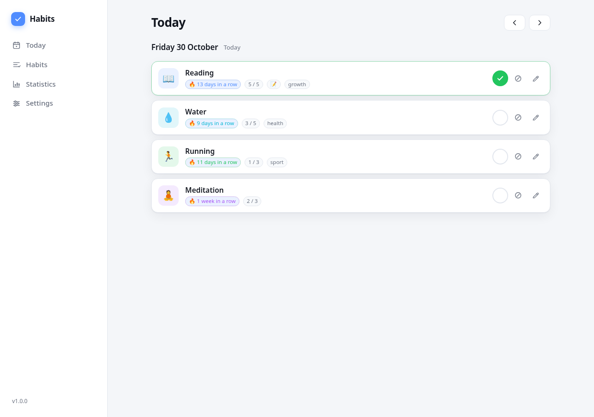
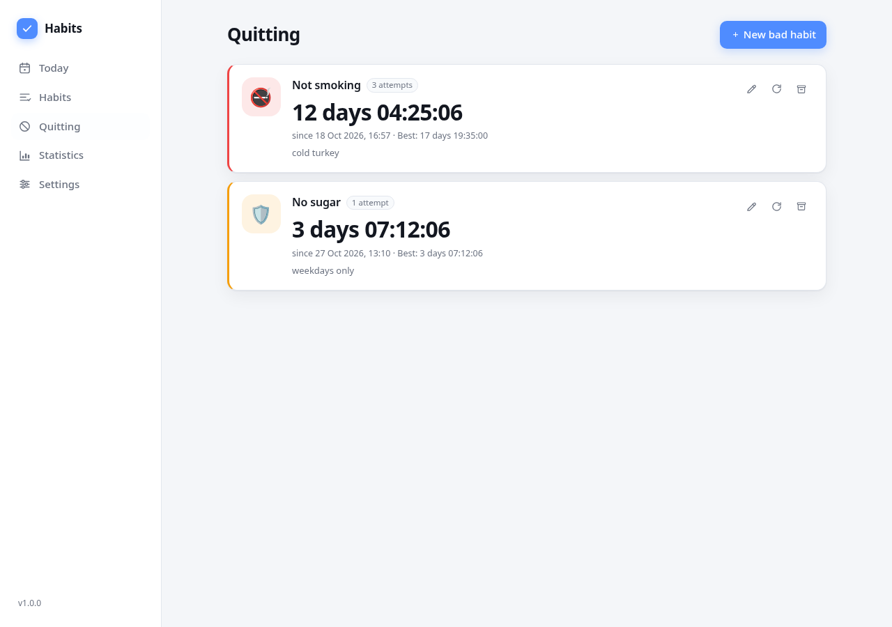

# habits

A local-first habit tracker with a C11 backend and a browser UI. One binary, no
dependencies, no accounts, no cloud — your data is a plain JSONL file next to the
executable.





There is also a **native desktop client** on [Raven](https://github.com/oscar-soirey/Raven)
(C11 + Vulkan): no browser and no web server, same core and the same JSONL file.


## Why

- **No dependencies.** Only libc and POSIX: `make` and run. No Node, no Python, no
  package manager, no Docker.
- **Local by design.** The server binds to `127.0.0.1`, there is no telemetry and no
  network access beyond your own machine.
- **Portable data.** The whole state lives in `data/habits.jsonl` — readable, diffable,
  easy to back up, easy to move to another machine.
- **Fast.** Starts in milliseconds and stays under a few megabytes of memory.

## Features

- Habits with a colour, icon, category and description.
- Three schedules: every day, selected weekdays, or N times per week.
- One-click marks: **done** or **skipped** (a skip does not break the streak), optional
  note for the day.
- Streaks (current and best), completion rate, and a 12-week heatmap.
- Edit past days, correct mistakes, browse history with the arrow keys.
- Archive habits without deleting their history.
- **Quitting tracker** for bad habits (`Not smoking`): a live timer with days and
  hours, best attempt and attempt count, one click to restart after a relapse.
- Three UI languages: English, Russian, Ukrainian. Light and dark themes.
- Atomic writes with a `.bak` copy; the data file survives `kill -9`.
- Export everything as JSONL with one click.

## Native desktop client (optional)

`src/desktop/` builds `habits-desktop`, a native window that talks to the same
`core/` and the same `data/habits.jsonl` as the web build. Nothing is served over HTTP.

Requirements: `libX11-devel`, CMake 3.16+, a C11 compiler and a Vulkan driver.

```sh
sudo dnf install libX11-devel cmake          # Debian/Ubuntu: libx11-dev cmake
./tools/get_raven.sh                         # clones and builds Raven into build/
make desktop                                 # build/habits-desktop
./build/habits-desktop --data ~/apps/habits/data
```

Screens: Today, Habits (create, edit, delete, archive), Quitting (live timer,
relapse reset, edit, delete), Statistics (streak cards and a 12-week heatmap) and
Settings (data path, version, JSONL export).

Not in the native client yet: day notes, the three UI languages, and drag-and-drop
ordering. Raven itself is young (0.1.x) and its API changes, which is why the web
build stays the default, dependency-free front end.

## Requirements

Linux with a C11 compiler (`gcc` or `clang`) and `make`. That's it.

## Build and run

```sh
make
./build/habits
```

The browser opens automatically. To build with CMake (e.g. in CLion):

```sh
cmake -S . -B build-cmake && cmake --build build-cmake
```

The native client is an optional CMake target and is off by default, so the web
build never needs X11 or Raven:

```sh
./tools/get_raven.sh
cmake -S . -B build-cmake -DHABITS_DESKTOP=ON && cmake --build build-cmake
```

## Command line

```
habits [options]

  --port <n>       listen on port n (default 8787, 0 = any free port)
  --data <dir>     data directory (default: <exe dir>/data)
  --web-dir <dir>  serve the UI from a directory instead of the embedded bundle
  --no-open        do not open the browser
  --verbose        log every request to stderr
  --version        print version and exit
  --help           print help and exit
```

Data location precedence: `--data`, `$HABITS_DATA_DIR`, `<directory of the executable>/data`.

Because the data directory sits next to the executable, install the app into a folder
you own (for example `~/apps/habits/`). If the directory is not writable, the program
refuses to start and tells you to pass `--data`. A second instance with the same data
directory is refused via a lock file, so two processes never overwrite each other.

## Data

```
habits/
├── habits               # the binary (UI embedded)
├── data/
│   ├── habits.jsonl     # snapshot of the whole state
│   ├── habits.jsonl.bak # previous version
│   └── locks/           # instance lock
└── README.md
```

`habits.jsonl` is UTF-8, one JSON object per line. The first line is metadata
(`schema_version`), followed by `habit`, `quit` and `entry` records. Dates are civil dates
(`YYYY-MM-DD`), so moving between time zones never rewrites history. The file is
rewritten atomically on every change; the previous version is kept as `.bak`, and a
malformed line is preserved as `habits.jsonl.corrupt-<timestamp>` instead of being
silently dropped.

## HTTP API

The UI talks to a small JSON API. It is intentionally local-only: requests must carry a
`localhost`/`127.0.0.1` `Host` header, and mutating requests must send
`X-Requested-With: habits` (which also blocks cross-site form posts from other pages).

| Method | Path | Purpose |
| --- | --- | --- |
| GET | `/api/v1/health` | status, version, data directory |
| GET/POST | `/api/v1/habits` | list / create |
| GET/PATCH/DELETE | `/api/v1/habits/{id}` | read / update / delete |
| POST | `/api/v1/habits/{id}/archive` | archive a habit |
| POST | `/api/v1/habits/{id}/unarchive` | restore a habit |
| GET | `/api/v1/habits/{id}/entries?from=&to=` | marks in a range |
| PUT/DELETE | `/api/v1/habits/{id}/entries/{date}` | set / clear a mark |
| GET | `/api/v1/today?date=` | the day's list with streaks |
| GET | `/api/v1/stats?habit_id=&from=&to=` | streaks, rate, heatmap |
| GET/POST | `/api/v1/quits` | list / create bad-habit counters |
| GET/PATCH/DELETE | `/api/v1/quits/{id}` | read / update / delete |
| POST | `/api/v1/quits/{id}/reset` | relapse: keep the best attempt, restart the timer |
| POST | `/api/v1/quits/{id}/archive` | archive / unarchive |
| GET | `/api/v1/export` | download the JSONL file |

Errors are JSON: `{"error":{"code":"invalid_name","message":"...","field":"name"}}`.

## Development

```sh
make test     # unit and API tests (no network, no fixtures)
make asan     # the same tests with ASan/UBSan (needs libasan)
make fmt      # clang-format
node tools/check_i18n.mjs   # the three UI dictionaries must have the same keys
make desktop  # native client, needs Raven: ./tools/get_raven.sh
```

The test suite covers date math, the JSON parser (including malformed input), the
schedule and streak rules, the storage layer (corruption, orphans, schema version) and
the HTTP API handlers.

Screenshots are in `docs/`.

## Project layout

```
src/
├── main.c            # arguments, data directory, locking, server startup
├── core/             # pure logic: model, schedule, stats, JSONL storage
├── infra/            # utilities: UTF-8, dates, JSON, HTTP, embedded assets
└── api/              # routes, validation, JSON serialisation
web/                  # HTML/CSS/ES modules, embedded into the binary at build time
tests/                # assert-based test suite
tools/embed_web.sh    # web/ -> generated C array
```

The core knows nothing about HTTP or files (time is passed in), which keeps the streak
and schedule rules easy to test.

## Troubleshooting

- **The browser shows `not found`.** The UI is embedded into the binary at build time;
  after changing files under `web/` rebuild with `make`, or run with `--web-dir web` to
  serve the sources directly.
- **`another instance is already running`.** Another copy holds the lock on
  `data/locks/habits.lock`; close it or start with a different `--data` directory.
- **`data directory ... is not writable`.** The binary sits in a system folder; move it
  to your home directory or pass `--data`.

## License

MIT — see [LICENSE](LICENSE).
