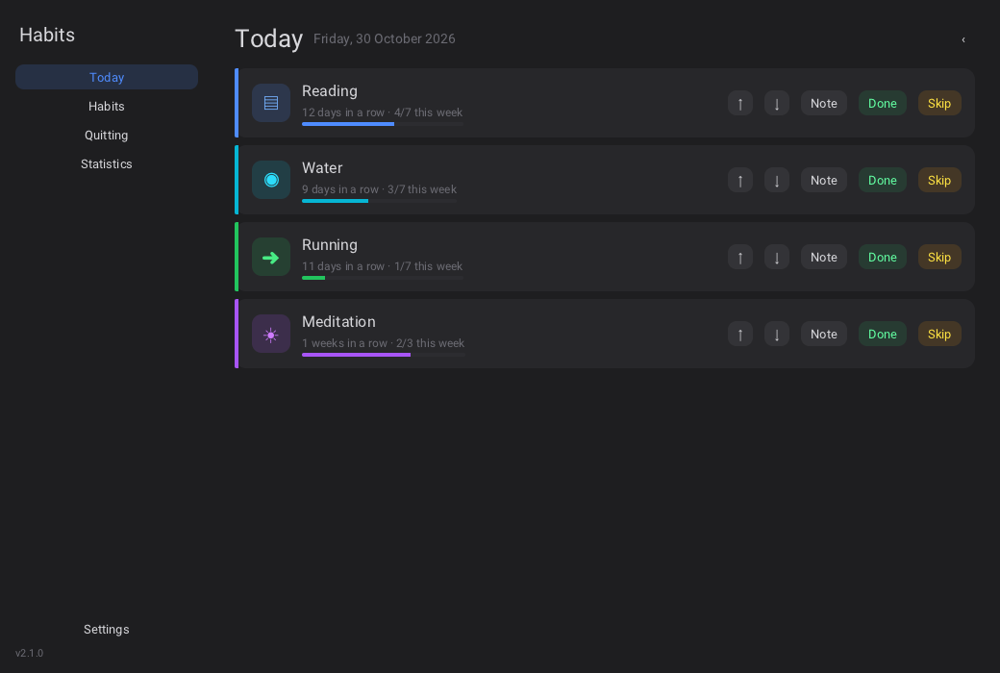
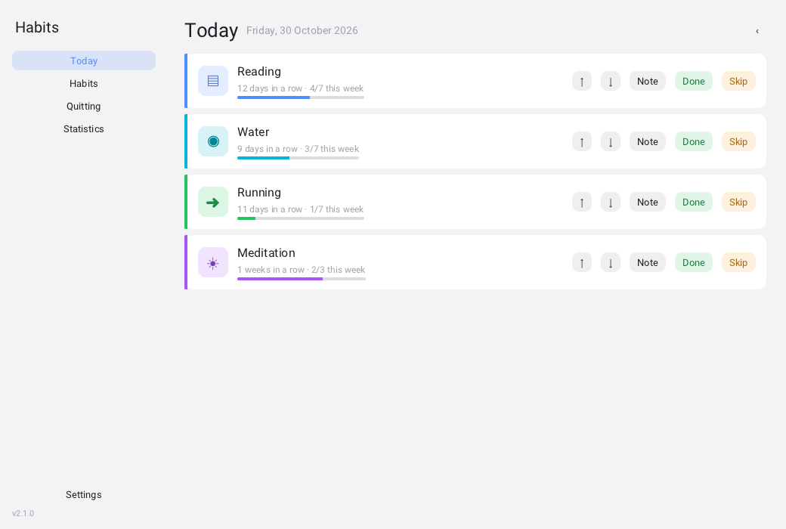
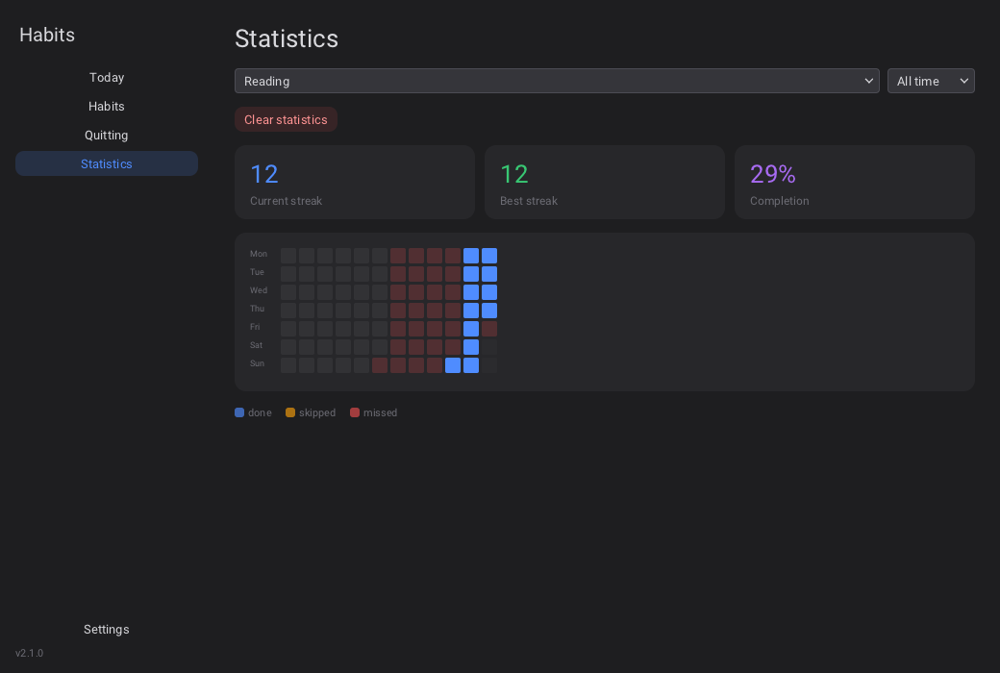
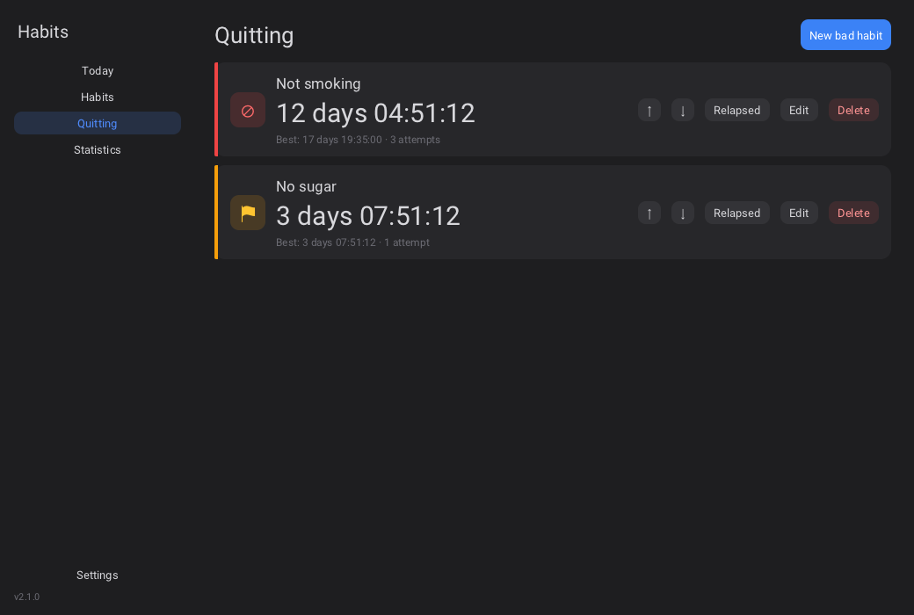

# Daychain

Daychain — a native habit tracker for Linux, written in C11 on top of
[Raven](https://github.com/oscar-soirey/Raven). One window, one binary, and a
plain JSONL file next to it — no browser, no web server, no database.

*Every day is a link in the chain.*



## What it does

- **Habits** with a colour, an icon and a schedule: every day, selected
  weekdays, or N times per week.
- **Two kinds of marks**: done and skipped (a skip does not break the streak),
  plus a note for the day.
- **Streaks and statistics**: current and best streak, completion rate, and a
  12-week heatmap.
- **Quitting counter** for bad habits: a live timer (days and `HH:MM:SS`), the
  best attempt, the number of attempts, and a "relapsed" reset that keeps the
  record.
- **History**: browse past days with the arrows and mark them there.
- **Reorder habits** with the ↑ and ↓ buttons on Today, Habits and Quitting; the order is kept in the file.
- **Archive** instead of deleting. Archived habits are listed on the Habits screen, where they can be restored or deleted for good.
- **Clear statistics** of any habit from the Statistics screen (the marks go, the habit stays); an archived habit can be deleted right there too.
- **Export** the whole database as JSONL from Settings.
- **Light and dark themes**, switched in Settings and remembered between runs.
- **Animations can be turned off** in Settings (Raven stops its transitions), also remembered.

The window looks like this:

| Light theme | Statistics | Quitting |
|---|---|---|
|  |  |  |

## Requirements

Linux with X11 (Wayland sessions work through XWayland), a Vulkan driver, a C11
compiler, CMake and the X11 development files:

```sh
sudo dnf install gcc cmake libX11-devel git      # Fedora
sudo apt install build-essential cmake libx11-dev git   # Debian/Ubuntu
```

Raven itself is fetched and built by the project — it is not vendored.

## Build and run

```sh
./tools/get_raven.sh      # clones Raven into build/ and builds libraven.a
make                      # builds build/daychain
./build/daychain
```

With CMake (for example in CLion), run `tools/get_raven.sh` first, then:

```sh
cmake -S . -B build-cmake && cmake --build build-cmake
```

## Data

```
daychain/
├── daychain             # the binary
└── data/
    ├── habits.jsonl     # the whole state
    ├── habits.jsonl.bak # previous version
    └── locks/           # instance lock
```

The data file keeps the names `habits.jsonl` / `habits.jsonl.bak` (and
`locks/habits.lock`) from earlier versions, so existing data needs no migration.

The data directory defaults to `<directory of the executable>/data`; use
`--data <dir>` or `$DAYCHAIN_DATA_DIR` to change it. Install the binary into a
folder you own (for example `~/apps/daychain/`), because the program refuses to
start when the data directory is not writable.

`habits.jsonl` is UTF-8, one JSON object per line: a `meta` line with
`schema_version`, then `habit`, `entry` and `quit` records. Writes are atomic
(temp file + rename) and the previous version is kept as `.bak`; a malformed
line is preserved as `habits.jsonl.corrupt-<timestamp>`. Two instances cannot
write the same file: the second one is refused by a lock.

## Command line

```
daychain [options]

  --data <dir>   data directory (default: <exe dir>/data)
  --screen <s>   start on today, habits, quitting, stats or settings
  --version      print the version and exit
  --help         print this help and exit
```

`DAYCHAIN_FRAMES=<n> DAYCHAIN_SHOT=<out.ppm> daychain` renders a few frames, saves
the window as a PPM image and exits — that is how the screenshots in `docs/`
are made (`tools/ppm2png.py` converts them to PNG).

## Development

```sh
make test    # core tests: dates, UTF-8, JSON, schedules, streaks, storage, quitting
make asan    # the same tests with AddressSanitizer/UBSan (needs libasan)
make fmt     # clang-format
```

The core (`src/core/`) knows nothing about Raven: it holds the model, the
schedule and streak rules, and the JSONL storage. The window (`src/desktop/`)
is the only place that talks to Raven.

```
src/
├── desktop/    the native window: screens, dialogs, drawing
├── core/       model, schedules, streaks, statistics, JSONL storage
└── infra/      UTF-8, civil dates, JSON parser and writer
tools/          get_raven.sh (fetch and build Raven), ppm2png.py
tests/          assert-based test suite for the core
```

## Limitations

- English only for now; the UI strings are plain C literals.
- X11 only (Raven draws through Vulkan); native Wayland is not supported yet.
- Raven is at 0.1.x and its API is still moving.

The earlier browser-based version of this app was removed in v2.0; it is still
reachable in the history at the tag `web-final`.

## License

MIT — see [LICENSE](LICENSE). Raven is Apache-2.0 and is built from source by
`tools/get_raven.sh`.
